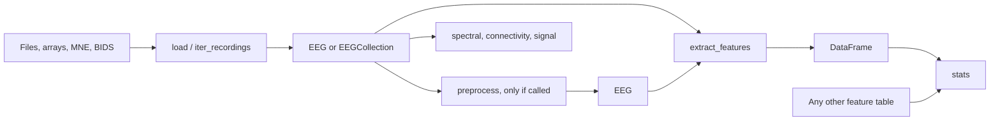

# Architecture

Each box is an entry point and an exit point. `feature_table` is a thin
loop around load, optional steps, and `extract_features`. It is not
required.

## Objects

`EEG` holds the array, sampling frequency, channel names, `"V"` or `"uV"`,
optional channel types, reference label, subject, session, condition,
annotations, and a provenance tuple. Continuous data has shape
`(n_channels, n_times)`. Epoched data has shape
`(n_epochs, n_channels, n_times)`. `EEG.n_epochs` is 1 for a continuous
recording so that a loop can visit it once. `describe()` reports 0 in
that field, together with `epoched=False`, so a collection table does
not look like a one-epoch study. Epochs stay inside their boundaries:
windowing, spectra, and connectivity never join the last sample of one
epoch to the first sample of the next.

`EEGCollection` does not require a shared sampling rate, montage, or
reference. `compatibility()` reports the differences. `require()` raises
when a caller asks for a match the collection does not have.
`align_channels(how="intersection")` keeps the shared names and does not
resample.

## Where code lives

| Path | Responsibility |
| --- | --- |
| `recording.py` | `EEG`, `EEGCollection`, channel alignment |
| `io/load.py` | Format readers and BIDS discovery |
| `preprocess/operations.py` | One function per preprocessing step |
| `algorithms/` | Entropy, fractal, and time-domain estimators |
| `spectral/psd.py` | Welch PSD and spectral summaries |
| `connectivity/metrics.py` | Cross-spectral connectivity and sensor-space correlation |
| `features/extract.py` | Catalog, names, and the extractor |
| `features/regions.py` | User-supplied channel groups |
| `signal/analysis.py` | Time-frequency, evoked measures, intertrial phase clustering, stationarity, autocorrelation, modulation |
| `stats/` | Design, tests, ordinary least squares, mixed models, concordance, multiplicity |
| `viz/plots.py` | Figures |
| `workflow.py` | Optional streaming feature table |

Algorithms are the single implementation used by the extractor. The
extractor does not contain a second copy of the formula.

## Units and metadata

MNE's EDF, BDF, BrainVision, FIF, and EEGLAB readers return volts, so
those paths set `units="V"`. An array may also be passed as `units="uV"`.
A file or a directory rejects `units` and any other unknown argument.
`zscore` sets `units="z"`. `to_volts` and `to_microvolts` refuse that
recording, and `to_mne` copies it without multiplying by a voltage
scale. `rereference` refuses it, because the mean of standard scores is
not an average reference. Average reference also needs at least two
channels typed as EEG. One EEG channel would be subtracted from itself.
Exactly two EEG channels produce a warning: one channel becomes the
negative of the other, and coherence on that pair is then 1.
`bandpass`, `notch`, `resample`, `detrend`, and `baseline_correct` warn:
those operations do not commute with the z-score. A BIDS `channels.tsv` can mark ECG, EOG, or
EMG. It is not used to rescale amplitudes, because the reader has already
converted the file to volts. A byte-order mark in `participants.tsv` is
accepted.

Filter limits stored on the MNE `info` object are copied to
`metadata["highpass"]` and `metadata["lowpass"]`, and from there onto
each feature row as `highpass_hz` and `lowpass_hz`, together with
`duration_sec`. Those fields describe the file. They do not cause a
filter to run. A missing limit stays missing. A stored 0 Hz stays 0. `to_mne` does not write
them back onto `Info`, because current MNE releases reject that
assignment. After a filter, reference, or resample, the recording keeps
the more restrictive of the previous limit and the new one. A requested
high-pass below an existing high-pass does not widen the passband on
the record. Resampling records the Nyquist frequency of the lower of
the original and new sampling rates, so upsampling does not raise the
low-pass. `notch` omits a line that sits above a recorded low-pass and
writes that skip into the provenance. Other lines in the same call are
still notched. Epoched data are notched one epoch at a time, because
`EpochsArray` has no notch method and the kernel must not run across
the boundary between epochs. The default transition bandwidth is 1 Hz.
MNE uses half of that width for each stop-band edge, and the Hamming
FIR length is 3.3 divided by that half-width, about 6.6 s. A band-pass
or notch whose kernel is longer than the samples being filtered raises
`ParameterError` instead of returning the distorted series MNE would
still produce. `bandpass` and `notch` default to channels typed as EEG.
A channel with no recorded type is treated as EEG. `picks="all"` includes
ECG, EOG, and stimulus channels. `to_mne` is the conversion used by those
steps and is public. Finite channel locations are stored on `ch_pos`
as head coordinates in metres, the first three entries of each MNE
`loc` vector. An unknown MNE location is zeros or non-finite and is
stored as a missing row. A recording in which every location is unknown
has `ch_pos is None`. `to_mne` restores the finite rows as a head
montage. Positions are not used by features or connectivity, and the
reference label is not inferred from them or from the spatial mean.

## What is left to the caller

- Which channels form a region. `COARSE_10_20` is an unofficial grouping
  of common 10-20 and 10-10 names, not a published region of interest.
  T3/T4 and T5/T6 are the older names of T7/T8 and P7/P8.
- Whether a recording should be filtered again.
- Which statistical test matches the design.
- Whether rows are subjects or technical replicates.
